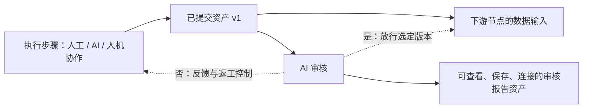

# AI 审核节点与受控返工方案

日期：2026-10-12。状态：设计，尚未实现。依据用户确认：审核输出“是/否”与反馈；不通过时按人工、AI、人机协作主体返工或停止。本文补充 [详细实施方案](06-implementation-plan.md) 与 [节点协同规范](05-node-coordination-standard.md)；首版新增类型增至 Agent、状态机、AI 审核三种。

## 1. 节点职责

建议名称“AI 审核”，类型草案 `ai-review`，首版 `contractVersion=1`。按明确标准审核固定版本的资产，输出通过/不通过及可操作反馈；每次调用审核一个已提交的版本集合。它是单次审核能力，配合受控返工形成循环，不自己改原资产、运行上游或启动另一个任务调度器。

通用性来自同一结论协议可服务于人工、单次 AI、AI Agent 和人机协作 Agent。复杂、多工具的审核工作可使用专业审核 Agent，最终提交同一审核结果协议。普通审核默认单次模型调用；必要的结构/格式校验优先确定性执行，模型判断只是任务范围内的质量结论，不是绝对正确性的证明。

人审核在人工或人机协作入口表达，不另建必需的“人工审核”类型；人与 AI 协作并不默认意味着人必然审核，是否有审核交接点由任务明确声明。

## 2. 与其他节点的关系



实线为标准数据依赖，虚线为明确标识的控制关系。审核节点读取资产；产出审核报告资产，原资产保留。下游读取原资产的已审核版本，不复制一份“通过后的资产”。没有适用的通过记录时，下游即使已有数据连接也不能在受控范围内启动。

每个审核节点配置一项显式返工绑定：受审核资产来源集合、负责修订的节点 ID、可信执行主体、通过时允许的下游范围、拒绝策略和次数预算。负责修订节点可能是资产的生产节点，也可能是人机协作 Agent；不根据“上一个节点”、标题、屏幕位置或资产节点类型猜测主体。

首次建图和修改绑定时验证所有目标、范围、能力和来源；一组资产首版只绑定一个明确的返工负责人。跨多个负责人拆分返工以后单独设计，不让模型任意指定整图修订。

审核负责给结论，主 Agent/公共调度器唯一负责执行控制，状态机负责校验阶段。没有主 Agent 时仍可单独运行审核并查看报告；若要自动返工，必须显式配置控制范围，由同一公共调度器处理。普通旧图不因放入一个审核卡片自动获得循环执行。

## 3. 标准输入输出

### 3.1 输入

复用现有 PortType，不使用普通业务节点不允许滥用的 `any`。审核标准正文放 `props.text`；模型、规则开关、Skill 版本、拒绝策略和绑定等固定配置放 `props.config`。

| 端口草案 | 类型                           | 基数/必填      | 内容                                         |
| -------- | ------------------------------ | -------------- | -------------------------------------------- |
| in-text  | text（允许现有 Markdown 兼容） | many，单项可选 | 已提交的文本/Markdown 资产                   |
| in-json  | json，json.any@1               | many，单项可选 | 实际业务 JSON 资产，原有 Schema 保留在输入包 |
| in-image | image                          | many，单项可选 | 图片资产引用                                 |
| in-video | video                          | many，单项可选 | 视频资产引用                                 |
| in-audio | audio                          | many，单项可选 | 音频资产引用                                 |
| in-file  | file                           | many，单项可选 | 已支持读取的文件资产引用                     |

整体必填规则：至少一个有效的、被明确选为审核对象的输入，并存在有效审核标准。各端口只有一组、多个同类素材放 many；整体规则由公共 readiness 与执行器共用，不能卡片和运行器各判断一次。上下文材料若经同类端口输入，配置中按稳定来源节点/端口/版本标明“审核对象”或“参考”，不能按内容猜。

首批执行只开放文本和 JSON；其他端口先按契约登记，未适配的类型明确阻断并说明原因。媒体审核需要本机模型模态能力与解析适配的真实验收，不能拿文件路径或缩略图当作完整审核。文件读取、视频抽帧、音频转写等业务加工仍关联明确能力节点；报告记录实际覆盖、截断和采样范围，不能把局部证据宣称为完整素材审核。新增 Schema 均为拟议，尚未加入注册表。

### 3.2 输出

| 端口草案     | 类型/Schema             | 基数/必填 | 内容                                                       |
| ------------ | ----------------------- | --------- | ---------------------------------------------------------- |
| out-review   | json，review.decision@1 | one，必填 | 唯一权威的审核结果，含结论、反馈、资产版本和规则版本       |
| out-feedback | text                    | one，必填 | 从 out-review 同一记录投影出的反馈正文，供人阅读或返工输入 |

界面将 `passed=true/false` 显示为“是/否”；不新增 boolean PortType，不把“是/否”直接当作两根普通数据输出线。通过/返工/停止为显式控制分支，不参与数据 DAG。需要其他节点读取结论时连 out-review 到声明兼容 Schema 的 JSON 输入，需文本反馈时连 out-feedback 到文本输入。

结构草案：

```json
{
  "schemaVersion": 1,
  "reviewId": "review-1",
  "cycleId": "cycle-1",
  "reviewNodeId": "node-review",
  "subjects": [
    {
      "assetId": "asset-1",
      "versionId": "version-1",
      "sourceNodeId": "node-producer",
      "sourcePortId": "out-json"
    }
  ],
  "criteriaVersion": "criteria-1",
  "passed": false,
  "feedback": "缺少每个镜头的时长，请补齐后重新提交。",
  "issues": [
    {
      "criterionId": "shot-duration",
      "assetId": "asset-1",
      "versionId": "version-1",
      "location": "shots[2].duration",
      "problem": "缺少时长",
      "suggestion": "为该镜头填写符合要求的时长"
    }
  ],
  "reviewRound": 1
}
```

reviewId、cycleId、版本、来源和轮次由宿主填充并校验，模型只返回允许的结论、标准检查项与反馈；不能伪造被审核版本、执行成功或返工目标。`passed=false` 必须有明确反馈；通过也保存简短依据。复核记录的输入、模型/Skill 版本、实际证据范围另与运行实例关联。

审核执行成功且结论“否”时，`meta.nodeRun` 是 success，审核业务结果 passed=false。模型不可用、响应解析失败、资产无法读取等是审核运行失败，无有效通过/不通过结论；不能将技术错误伪装成质量否决，也不能默认放行。

## 4. “否”之后如何处理

| 负责修订的主体             | rejectPolicy=rework                                                              | rejectPolicy=stop                            |
| -------------------------- | -------------------------------------------------------------------------------- | -------------------------------------------- |
| 人工                       | 原人工节点显示反馈与待修改，释放执行资源；人提交新资产版本后再次审核             | 停止该受控分支；保留资产和反馈，供人后续修订 |
| 纯 AI Agent / 单次 AI 处理 | 新尝试固定原任务、原输入、被拒资产版本和反馈；自主修订/重做，再提交新版本        | 停止分支，任务显示未通过审核及可定位原因     |
| 人机协作 Agent             | 把反馈呈现在该节点，等待人讨论、补充或调整；人明确提交继续后 AI/人完成修订再审核 | 停止分支，保留会话、资产与反馈               |

任务模式来源于可信节点配置与本次快照，不能由审核模型决定。审核不通过不把原本成功的生成运行改成 failed；另记录“资产未通过审核”和返工任务。停止分支与用户取消、执行失败分别表达；是否终止整个 Flow 由声明的状态机规则决定。

AI 返工上下文至少包含原目标、审核标准、原输入快照、被拒资产、最新反馈以及有界的历史反馈摘要。反馈标明来源 reviewId，不替代系统约束或扩大工具权限。单次处理节点通过明确的反馈输入端口/适配契约接收反馈；不能给没有反馈能力的媒体/代码 executor 偷塞配置、改用户原文或假装能自主修订。未适配的节点显示“自动返工未支持”，人工重新配置仍保留。

人工和人机协作的“继续讨论”不会自动重审；提交新版本后才产生复审请求。同一版本的重复提交返回原回执。需要对同一版本重新评估必须显式新建审核尝试，并保留旧结论；改变标准、模型、Skill 或证据范围后不复用旧结论。

## 5. 通过、循环与版本规则

通过记录绑定审核节点/修订、被审核版本集合、标准版本及实际执行证据。下游启动时验证该记录并固定同一版本集合；不能审核 v1 后因上游选区变化直接使用 v2。新资产、新标准或绑定变化使旧记录对新任务不适用，需重审。

首版允许一个版本集合得到一个整体结论；多资产的 issues 分别定位。部分通过不隐式放行，确有独立验收要求时拆成不同审核范围。下游完成状态与审核通过分别保存。

返工循环：已提交 v1 → 审核否 → 返工/人工等待 → 提交 v2 → 复审 → 是则放行。反馈返回的是控制事件与新尝试输入，禁止创建普通反向数据边把原 DAG 变成环。控制事件携带 reviewId/cycleId/revision/commandId；原始输入快照不被本次反馈覆盖。

默认建议最多 3 次返工，即初审加最多 3 次复审，共最多 4 轮；次数可配置且有整体执行预算。审核模型技术重试单独计数，不消耗质量返工次数，也不能因此无界请求。耗尽后进入阻塞/停止状态并保留最新反馈；人工主动增加预算作为新修订，不偷偷重置计数。

循环期内下游保持待审核；首次运行先保证有 gate，不能资产刚产出便启动下游再等待审核结果。受控范围内手动执行也走同一 gate；主动解除审核关系需明确图变更和新快照，不能绕过审核自动继续。

## 6. 保存、恢复与画布呈现

结果仍遵守 `props.config/text`、`meta.nodeRun/nodeResult` 与注册 `projectOutputs` 的边界。审核报告作为 JSON 资产可物化到现有 JSON 节点；审核卡片和资产节点引用同一份报告，不独立维护结论副本。反馈端口只投影报告中的 feedback。

卡片显示“是/否”、简短反馈、审核轮次、被审核资产引用及返工/停止状态；技术错误显示运行失败。标准和策略在设置中编辑，长反馈/检查项通过统一详情查看；被拒资产仍能查看。人工或人机协作节点显示反馈和待处理，纯 AI 节点显示当前返工尝试；过程都在画布。

UI 遵守 NODE_UI_STANDARD §19、单排引用与隐藏滚动条规则；新增身份拟归“流程”分类，颜色/图标变体在代码实现前正式登记 NODE_COLOR_SPEC，不在本次擅自添加组件配色。节点内部空白/标题/图标可选中拖动，卡片输入双击编辑。

持久化审核记录、固定版本、返工次数、人工等待、命令回执及待物化结果。重开先校验版本和真实回执，不重复已完成审核或生成；结果未知时需核对。迟到的旧审核不能释放新版本 gate，迟到的返工结果不推进已停止分支。日志不是恢复真值。

## 7. 实施阶段与验收

| 阶段 | 交付                                                                                     |
| ---- | ---------------------------------------------------------------------------------------- |
| C1   | AI 审核类型/端口/Schema/颜色登记、卡片和规则设置、显式审核与返工关系                     |
| C2   | 固定资产版本、审核报告资产、通过 gate、回执；确定性审核 fixture 验证，不宣称真实 AI 审核 |
| C3   | 文本/JSON 真实模型审核；人工/纯 AI/人机协作三种返工路径；反馈上下文适配                  |
| C4   | 人工等待/返工中重开、轮次恢复、迟到结果、导入重映射与可复用审核子图                      |

必验：三类主体各自返工通过；拒绝即停；次数耗尽；模型技术失败无 verdict；坏 JSON 拒绝；审核 v1 不放行 v2；标准变化重审；多个 JSON/文本输入不混角色；同命令不重复生成；反馈不改原快照；数据拓扑不成环；人工等待重开；迟到结果不推进；报告资产能连接；旧节点和手动流程回归。

代码实现必须提供 ActiveNodeTypeId、NodeTypeSpec、contractVersion、端口与 Schema 注册、自注册 executor/projectOutputs、持久化与失败测试，通过 node-compliance、contract、适用 UI 验收和全量 npm run verify。本次未加入上述实现或运行测试。

## 8. 日志影响检查

本次仅 Markdown 方案，不涉及应用运行路径，不新增日志。后续使用日志检查模板并更新 LOGGING_COVERAGE；公共执行器记录审核/返工业务开始与唯一终态，网关记录模型失败阶段；审核结论/返工调度补适用关联，不重复公共终态。

关联 projectId、审核/返工节点 ID、task/run/nodeExecution、reviewId/cycleId、资产版本引用和轮次；允许记录是否通过、数量、耗时、次数、错误码。不记录审核标准、反馈正文、资产正文、提示词、回复、文件路径或 Key。日志故障不改变审核结论、gate 或资产提交结果。

需验证通过/否决/技术失败/预算耗尽/取消/恢复、敏感样例脱敏和写日志失败。当前未覆盖边界为整个新节点及控制循环尚未实现；文本/JSON 为首批，媒体审核、复杂多人返工、自动放宽标准或 AI 直接覆写资产均未支持。
