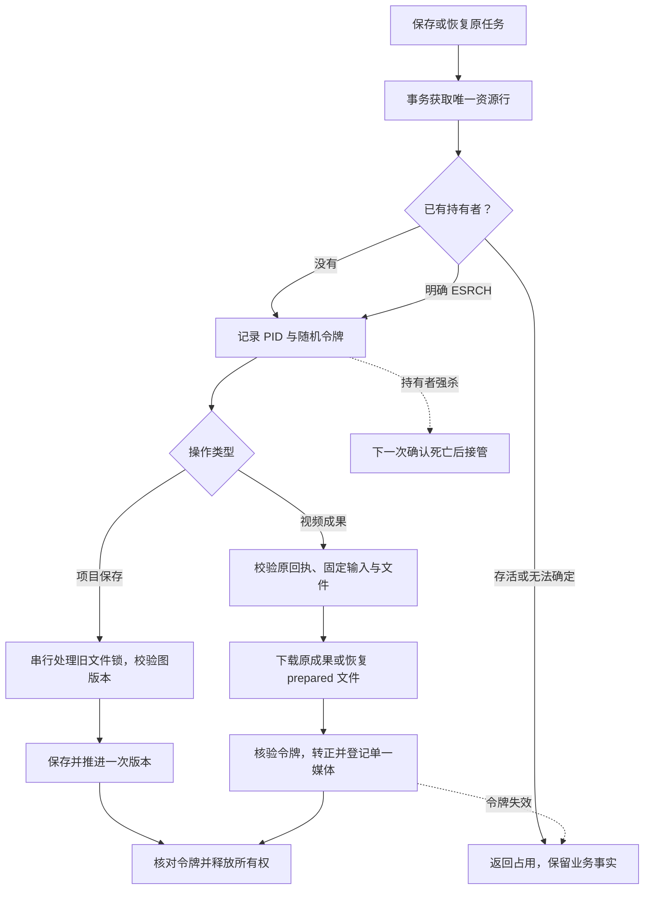

# C4：多进程恢复竞争与遗留锁争抢

日期：2026-10-14。基于已同步的 `58a802cafa1c2d37d1e1e24d1905f769edeb1685`；本包为本地开发，未提交/推送，安装包未更新。本文为最新接续入口，23–25 及上一份总 handoff 中并发未覆盖说明保留为历史记录。

## 解决的问题

原项目文件锁的“检查死亡 PID → 删除旧文件 → 创建新锁”缺少跨进程仲裁，两个恢复者可能同时通过检查。视频虽有固定媒体身份和同进程 Promise 合并，两个进程仍可能同时截断 staging 文件。只按锁年龄接管还会误伤暂停但存活的写者。

本包使用共享 app.db 中的 `process_locks(resource,token,pid)` 仲裁项目保存和单任务视频成果物化。SQLite `BEGIN IMMEDIATE` 仅覆盖获取、接管和释放；下载、文件摘要和异步文件操作期间不持有数据库写事务。

## 实现备注

- 相同数据目录、相同资源名只允许一个持有者。随机令牌限定每一次所有权；按资源与令牌释放，旧持有者不能删除后继锁。视频在关键写入、转正和媒体事务前核验所有权。
- 活 PID 不因超时被抢占；仅明确 `ESRCH` 可替换所有权行。PID 复用、非法 PID、权限不足或其他探测不确定保持阻断。
- 项目保留 `.write-lock` 兼容协议；数据库所有权覆盖旧锁检查、删除与创建。旧空锁仍有 30 秒保护期；有 PID 的旧锁还要求持有者死亡。数据库死亡资源行本身无需年龄保护。损坏旧锁不强制删除。
- 项目仍校验乐观版本；晚到恢复者返回占用或版本冲突，不重复推进版本。工作区保存使用相同保护。
- 视频按原 projectId/taskId 排他，继续复用固定输入、reserved/prepared/committed、SHA-256 和媒体冲突检查。强杀后部分下载可重下原成果；prepared 可离线恢复，不提交新计费任务。
- 同进程 materialize 合并保留；跨进程占用用既有 `GraphWriteInProgressError` 返回。查询、生成和重启轮询遇到占用不把持有者状态误标 unknown。可稍后明确核对原任务，无自动锁轮询或生成重放。
- 持久停止阻止公共核对发布成果，prepared 保留；明确继续原任务后恢复，无重复下载。停止与远端撤回仍分开。

数据库升到 **v17**，只新增所有权表。迁移 `BEGIN IMMEDIATE` 后重读版本，避免两个 v16 启动者重复建表；失败关闭连接，不缓存半初始化数据库。升级后旧 v16 应用拒绝较新数据库，不能手工降低 user_version 回退。

## 验证与审查

独立进程测试使用原 SQLite/文件代码，以屏障制造争抢和强杀，未用同进程 mock 代替并发。隔离临时目录、当前 Electron native ABI、隐藏进程退出清理。

新增 **15 项**覆盖活项目写者与老化锁、旧空锁/死亡锁双竞争、活视频下载占用、下载中/prepared 后强杀双接管、旧令牌写入/释放拒绝、迟到物化不发布媒体、查询不覆盖持有者状态、持久停止与明确继续、两个 v16 启动者迁移、四种存活或不确定 PID。六文件最终 **73 项通过**，含既有保存、成果强杀、迁移及供应商核对。最后轮询状态保护另跑视频诊断/轮询/查询回归，三文件 **32 项通过**。

完整 `npm run verify` 串行退出码 0：168 文件/1824 通过/1 既有跳过，模型另 2；lint、两端/模型类型、日志门禁、17 浏览器脚本、生产构建及 11 组隐藏桌面全部通过。本次全量收集的是首批 11 项竞争测试，后补 4 项和迁移/轮询补强不能计入该全量结果；最终六文件 73 项、三文件视频 32 项及 lint、node 类型、日志门禁和生产构建再次通过。

证据 `qa/c4-contention-20261014/verify.log`、`directed-final.log`、`video-final.log`、`lint-final.log`、`typecheck-final.log`、`logging-final.log`、`build-final.log` 被忽略，不上传测试 DB、媒体或个人配置。既有受跟踪 QA 截图/报告恢复，隔离 worker 清理；个人模型目录/凭据和旧桌面安装未修改，无付费生成/真实远端撤回请求。

按 code-review-and-quality 五轴复核：唯一资源行与所有权检查保证竞争边界；小型共享模块避免重复接管；复用公共保存/成果协议；参数化 SQL、不记录令牌/路径/凭据；短事务、摘要流式读取、无占用轮询。令牌替换是主动故障注入，正常协议不抢占活持有者。

## 日志自查

复用公共 project.save 开始/唯一终态、task.control.started/completed、下载和 media.persist。锁模块只抛稳定占用异常，不重复业务生命周期，不记录 resource/随机令牌/PID。业务依据来自所有权行、SQLite/文件回执，不根据缺日志接管。

control 占用返回保守 unknown 核对结论，但不修改持有者任务状态；代表本次未获得成果写权，不是供应商失败。生成/重启路径用既有诊断终态报告操作失败，保留任务事实。迁移错误沿启动错误传播，无新增网络或轮询。原诊断和成果强杀测试继续覆盖 logger 失败不改变结果、终态配对及敏感内容排除；本包竞争 worker 验证业务事实，不证明全部竞争进程完整 trace 树或真实供应商诊断。强杀不补造终态。

## 下一步与边界

限定同机器、共享相同数据目录的新代码进程；不保证混用旧版本、不同路径别名/网络共享数据库或人为篡改资源表时所有文件操作原子性。不把它称为跨机器分布式租约。

下一包优先 **C4 组合故障验收**：串联 unknown 核对、停止、保存中断、成果 prepared、持有者强杀和竞争接管，验证公共任务与画布恢复闭环。专用原子取消供应商仍需独立真实证据，Ark 混合 DELETE 不自动调用。物理掉电/fsync、磁盘损坏、长期故障组合、真实视频解码/计费/撤回、媒体/并行 Agent 和桌面打包发布未完成。
