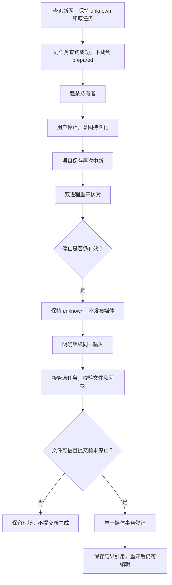

# C4 组合故障验收与停止竞争修复

日期：2026-10-14。本包延续 [26 包](26-c4-recovery-contention.md)，工作区基于已同步提交 `58a802cafa1c2d37d1e1e24d1905f769edeb1685`，包含尚未提交的 26 包。本包未提交/推送，安装包和快捷方式未更新；不能把工作区状态当作远端已上线。

## 本次验收路径

固定原 projectId/nodeId/taskId/供应商身份及输入，查询断网后保持 unknown；再次核对下载原成果，在 prepared 回执后强杀；用户持久停止；同一项目保存再次强杀；两个新进程核对/竞争恢复；明确继续原输入；离线恢复唯一媒体，继续保存并重开项目。

## 六条组合场景与结果

| 场景 | 解决的问题 | 断言 |
| --- | --- | --- |
| prepared 强杀 + 停止 + tmp 保存强杀 + 双进程继续 | 半写快照是否覆盖已保存图 | 保留 v1；继续后保存只推进一次 |
| 同上，文件已转正再强杀 | 文件新版本与旧 DB 是否永久错位 | 打开校准到 v2，明确保存可继续 |
| 同上，DB 更新事务中强杀 | 回滚后是否丢失有效文件或重复成果 | 文件/DB 校准，唯一媒体与任务 |
| prepared 损坏 + 停止 + 转正保存强杀 + 双进程继续 | 冲突是否错误回退到重新计费生成 | unknown、无媒体、下载次数不增加、保留快照 |
| 恢复转正期间再次停止 | 异步窗口是否越过持久停止 | 文件保留，媒体事务不提交；明确继续后恢复一次 |
| 明确离线恢复时 logger 抛错 | 诊断故障是否改变业务提交 | 原任务成功、唯一媒体、引用仍可保存 |

所有成功路径保持一个 task、一次原成果下载、一个媒体身份；生成 POST 和删除/撤回请求计数均为 0，所有非预期网络请求为 0。变更输入的“继续”拒绝为 TASK_OUTCOME_UNKNOWN，不释放原占用，不提交新任务。停止期间可以查询供应商事实，但不下载或发布。

组合 worker 使用真实项目仓库、SQLite/文件、公共 submitVideoTask/cancelVideoTask/controlVideoTask/finalizeVideo 路径；仅拦截 fetch 返回固定 Ark 协议夹具和私有字节，并注入 fs/SQLite 切点。没有实际调用供应商或付费生成。保存使用最小测试 snapshot 验证引用与版本一致性，**不等于视频节点 UI/解码的端到端验收**。跨进程存活/死亡/PID/令牌争抢继续由 26 包屏障测试覆盖，本包并发重开不代替那些确定性排他测试。

另外复验真实隐藏 Electron renderer 的 unsent、保存请求已接收、提交后回复前、写入失败四类中断：崩溃重开可读取权威快照，并经公共 IPC 继续编辑保存。公共保存开始/终态分别 2/2、3/3、3/3、3/3，合计 11/11，正文排除且无模型请求。该证据与组合 worker 分开，不把分别通过的场景称为同一个视频 UI 全链路。

## 本次发现并修复的问题

`recoverVideoAsset` 进入前检查停止，异步摘要/目录创建/rename 后仍可能收到新停止。旧实现会把任务留在 unknown，但媒体和 committed 回执已经登记，跨过了用户的停止意图。

现在在转正前和媒体登记事务内重新读取任务持久 cancelRequested。停止则抛稳定 VIDEO_MATERIALIZATION_STOPPED；已验证文件保留、prepared 不升级，明确继续后可从 staging 或已转正文件恢复。数据库 v17 和原固定输入/所有权协议不变；停止在媒体事务提交之后到达不追溯撤销已提交成果。

回归先复现失败，见 `stop-race-before.log`：旧实现错误出现一份媒体和 committed。修复后同一断言通过，未放宽期待结果。恢复诊断保留稳定 stopped 原因，不用原始异常或私有内容构造日志。

## 日志自查与证据

复用 task.control 开始/唯一 completed、media.download 和 media.persist 开始/唯一终态；不新增重复事件。保留新核对 trace/span 与原 taskId。逐 trace/span 验证存活 control 无重复终态；prepared 强杀只留下一个不可观察完成的 control 和 persist 开始，不补造终态，download 已完成且配对。

实际捕获事件排除假密钥、提示词、视频字节、临时绝对路径、签名参数和损坏字节；logger 抛错不改变提交。组合测试直接调用项目仓库，不伪造公共保存诊断；保存开始/终态和正文排除由真实 renderer 测试检验。没有宣称完整竞争 trace 树。

最终定向六文件 **74 项通过**：新增 6 条组合、15 条竞争、14 条成果强杀/冲突、27 条供应商任务核对、9 条项目保存强杀、3 条视频诊断。四类 renderer 复验通过。

完整 `npm run verify` 串行退出码 **0**：169 文件/1833 项通过/1 既有跳过，模型另 2；lint、两端/模型类型、日志门禁、17 浏览器、生产构建及 11 组隐藏桌面全部通过。本次全量收集首批 5 条组合场景；后补 logger 故障场景、生命周期检查和 stopped 诊断原因补强由最终 74 项及再次 lint、node 类型、日志门禁覆盖，生产构建/桌面阶段运行时已包含最终业务源码。未把后补项算入全量单元计数。`git diff --check` 通过，测试生成的受跟踪 QA 图/报告已恢复。

本机证据目录 `qa/c4-combined-20261014/`：`directed.log`、失败复现 `stop-race-before.log`、`directed-fixed.log`、`directed-final.log`、`verify.log`、`renderer.log`、`lint-final.log`、`typecheck-final.log`、`logging-final.log`。真实 renderer 报告复制到本目录的 `renderer/`。QA 被忽略；临时测试目录/worker 在退出后清理，不上传凭据、测试 DB 或媒体。失败记录保留，不用后来成功覆盖。

按 code-review-and-quality 五轴复核：停止检查处于提交事务内；只增量修复成果模块，不另建恢复系统；随机令牌与输入绑定未放宽；诊断只使用稳定原因；无新网络重试、后台扫描或长事务，异步窗口用独立进程屏障复现。

## 下一步与未覆盖范围

本包完成上述本地、受控协议的组合验收，不代表完整 C4 或所有故障排列已完成。仍未覆盖物理掉电/fsync、磁盘损坏、长时间压力/反复磁盘满、真实供应商计费及原子远端撤回、视频解码和视频 UI 全链路、媒体/并行 Agent 调度。Ark 混合 DELETE 继续不自动调用。

用户随后明确当前仍为初始项目开发阶段，不需要打包或旧项目迁移专项；接续改为 [媒体节点接入 Agent Flow，先视频](28-video-agent-adapter.md)。专用原子取消供应商与真实视频路径另立受控验收，不以本地夹具替代供应商证据。26–27 包尚未提交/推送，用户明确同步时一并提交代码、测试与备注。
