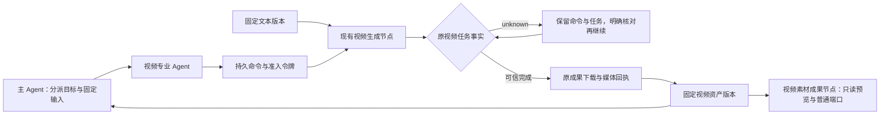

# 媒体节点接入 Agent Flow：文本生成视频首包

日期：2026-10-15。接续 [C4 组合故障验收](27-c4-combined-failure-acceptance.md)。工作区仍以已同步的 `58a802cafa1c2d37d1e1e24d1905f769edeb1685` 为基线，包含尚未提交的 26–28 包；本包未提交/推送。按用户最新要求继续功能开发，不做安装包、发布或旧项目迁移专项。

## 已交付路径

在画布创建主 Agent、状态机、视频专业 Agent、已有视频生成节点与文本材料。专业 Agent 的允许范围包含该视频节点，选择 `node.execute@1`；视频配置显式为文生视频，选择已有供应商视频模型。主 Agent 通过既有 dispatch 工具分派专业任务，视频执行复用原公共 executor/gateway。

桌面已验收“主控分派 → 原视频任务 unknown → 关闭进程 → 重开 → 核对 → 明确继续 → 专业任务完成 → 主控收集 → 固定视频节点交付”。全过程 **一个生成 POST、一条视频 task、一次下载、一份媒体身份**；固定素材能解码、单击选中、拖动、双击预览，并通过原 `out-video` 消费。

## 支持范围与配置

| 能力 | 本包状态 |
| --- | --- |
| processor v1 原调度 | 保留既有行为 |
| video v7 文生视频 | 已适配；本节点固定正文，可另接一条 `in-text` 固定文本/Markdown 输入 |
| 图片/视频/音频参考、提示词包、多条文本连线 | 尚未适配 Agent 调度；既有手动视频节点保持可用 |
| 主控分派与专业 Agent 自主执行 | 已接既有工具、预算、状态机、控制范围及固定输入 |
| 固定视频资产 | 原 mediaId/相对路径/MIME，不复制视频字节；成果节点用既有 video-asset v2 |
| Agent 输出 | 保留原文本/JSON 端口；视频引用作为结构化 JSON 描述，原 refs 仍指向原生视频版本；实际视频由成果节点承载 |
| 成功、failed、cancelled、unknown 原任务接回 | 同一已绑定命令不再生成新任务；不把 failed/cancelled 自动当成可重生成 |
| 执行中断后的明确接回 | waiting/reconcile 的原 Agent 任务可核对并明确继续；无可信任务绑定则继续阻断 |
| 停止 | 沿原任务持久停止，保留 unknown 占用与远端 ID；不表示远端已撤回，不自动复活已取消的 Agent |
| 视频 AI 审核、媒体 Agent 下游自动处理/并行 | 未适配；文本/JSON 审核不据视频元数据宣称画面质量通过 |
| 上帝 Agent 自动建视频图 | 本包不改文本模板 builder；视频 Flow 由用户按既有节点设置与连线构建 |

首包限制在授权前校验；不能因为节点已有手动 executor 就开放所有媒体类型。视频节点需显式设置 `mode=text`；其 v7 正式端口与桌面注册表逐字段比较，未修改现有节点契约版本或新增节点类型。工具说明同步为数据处理或视频节点。

## 原任务身份与恢复协议

- 命令仍使用 project/task/agent/target、固定版本输入、语义修订、contractVersion 与持久 lease；视频入口另外验证该命令确为 v7 视频授权，处理节点的准入令牌不能转作视频提交。
- 新视频的本地 taskId 由 projectId/commandId 确定，原 tasks 主键作为跨进程首次提交的最终挡板；冲突方在 POST 前失败，后续只能核对原 task。无新数据库版本或依赖。
- tasks.input 保存 flowCommandId，完整输入仍绑定供应商/模型、提示词、参数和连接身份。接回时匹配原 task；输入改变、错误令牌、未准入及未适配参考素材在副作用前拒绝。
- 同命令成功结果也复用原 task，不再按“任务已成功所以可再生成”处理。没有绑定任务的失联命令不能据“没找到”重新 POST；仍为 unknown。
- executor 因 unknown 失败或本地停止跳过时，ledger 不将命令当普通失败释放占用。供应商已成功但画布仍留失败运行记录时，命令保持“待呈现”，不丢弃真实成果。
- 明确核对视频会调用现有可信任务核对/本地成果恢复，不提交生成。绑定可接回时显示独立 ready 原因；用户再明确继续，工具桥只重建原视频命令 grant，复用 lease/run 与视频 task，沿公共 executor 补结果与保存，再原子提交固定版本。processor 的 uncertain 命令继续不重发。
- 停止按 projectId/Agent taskId/commandId/targetNodeId 定位原视频，仅改变其持久意图；不影响其他 Agent、项目或已终结视频。主控停止经原子任务的停止传播到专业任务。已取消 Agent 的终态不被此包偷偷改回运行。

视频长任务可能越过桌面桥的 60 秒等待，Agent 保留 waiting/reconcile，底层仍使用原任务事实。明确继续的预算仍受原 Agent 任务限制，不通过恢复绕过工具/决策预算或变更图修订。

## 固定成果与画布呈现

资产版本 value 新增原生 video 类型，提交必须匹配同命令的成功 task、committed 物化回执及 media 表的 ID/路径/MIME。不能只凭保存的 nodeResult 或媒体路径宣布成功。版本与命令回执仍在同一 SQLite 事务内，重复 commit 返回同一版本。

Agent 的文本/JSON 输出规范保持；视频值被明确适配成 JSON 引用供主控收集，refs 不改成 JSON 资产身份。固定视频素材节点 pinnedOutput 保持原生视频值，普通 out-video 按原值消费；只读预览从 pinnedOutput 取值，改 props/选择历史不改变版本。复用原媒体布局、指针 guard、双击预览，不显示替换或可编辑副本按钮。

命令执行期间先保存生成节点结果，不提前新增媒体节点，以免改变已准入的语义图。固定版本成功后由 Agent 成果呈现创建素材节点；主/专业 Agent 交付相同视频版本时复用已存在的版本节点，避免主控再次创建重复素材。未改变手动执行的普通素材物化。

## 验证与证据

五文件最终 **83 项**定向通过，包括 6 项视频命令适配、5 项原视频绑定/拒绝检查、3 项端口/固定预览检查、1 项跨 Agent/项目停止隔离，以及原 runtime、供应商恢复回归。旧资产/公共命令 71 项首轮回归、96 项修复回归及竞争/适配复验 74 项均保留各自日志，不能累加成互不重复的测试总数。

主回归 `npm run verify`（视频尾门禁登记前）串行退出 **0**：171 文件/**1849 项通过、1 项既有跳过**，模型另 2；lint、两端/模型类型、日志门禁、17 浏览器、生产构建和 11 组原隐藏桌面通过。最后复核补强恢复方法自身的命令签名校验、PID 复用检查、固定预览布局及提示后，83 项定向、两端类型、lint、日志门禁、当前源码编译及视频双进程专项再次通过。

新增 `npm run test:agent-flow-video` 并加入当前 verify 尾部；登记后独立执行退出 **0**，证据 `desktop-command-final.log`。不把后补或新增尾门禁称作已在此前单次全量中执行。使用现成开发编译产物验收，没有生成安装包或发布桌面应用。

最新真实隐藏 Electron 双进程验收 `desktop-command-final/`：主控真实画布/公共 executor/IPC、SDK 工具协议夹具、unknown 持久、关闭重开、原命令明确继续、固定成果、原生视频 metadata 解码、单击/拖动/双击预览通过。SDK 决策使用合成服务，9 次模型请求；媒体为 FFmpeg 生成并存于 `test/fixtures/agent-video.mp4` 的 1735 字节、0.5 秒 MP4，运行时只复制到隔离目录，新增门禁无需 FFmpeg 运行依赖。供应商响应由测试 fetch 返回。**没有请求付费视频或实际供应商计费/撤回**，不能把这称为真实模型自主决策或真实供应商验收。

证据根目录 `qa/agent-video-20261015/`：首次 `verify.log`、日志门禁登记前 `verify-fixed.log`、最终主回归 `verify-accepted.log`、`directed-final-accepted.log`、`review-final.log`、`desktop-command-final.log` 与同名报告目录、`build-command-final.log`、`lint-accepted.log`、`types-*-accepted.log`、`logging-accepted.log`。初次失败包括缺状态机的测试图、核对请求漏 eventId、旧测试桩/投影接线，以及一次强杀竞争断言；失败记录保留。该次竞争失败未记录 PID，不能断定其原因为 PID 复用；后续定向与两轮全量单元通过。测试现已增加实际 contender/owner PID 信息，并单独处理能观察到的 PID 复用保护，不用无条件重试掩盖非复用失败；唯一媒体、下载数量和任务事实断言仍保留。QA 被忽略，临时目录/隐藏窗口/测试进程退出清理，受跟踪 QA 生成物已恢复；个人模型、密钥和本地项目未改动。

## 日志检查与审查备注

复用 command.operation、agent.desktop/coordination/runtime、model.request、node/workflow、task.control、media.download/media.persist、asset.submit/placement 及公共保存，不再新增一套视频 Agent 生命周期。关联原 command/run/task/固定版本及本次 trace/span；恢复身份不由日志推断。只有完成事实和固定版本可以交付主控，unknown 日志不释放占用。

双进程实际诊断验证 Agent 操作开始/唯一终态与恢复 trace，排除假 Key、材料正文；视频生成/核对/下载/版本继续使用生产日志。隔离 media:// 文件传输不重复记录业务生命周期，测试入口职责在 logging-allowlist 登记；此项不豁免秘密、裸 console 或新的生产调用者。停止子模块通过原 cancel/control 路径记录事实。Logger 故障既有回归继续通过。

按 code-review-and-quality 五轴复核：正式端口与固定输入、授权类型与主键挡板、任务事实到资产的校验、unknown/停止不释放、纯视频恢复与 processor 不重发分开；小型共享适配函数只处理已支持类型，复用执行器/素材节点与媒体协议；短事务与流式下载保留，没有二进制进入 Agent 上下文，没有新外部依赖。

## 接续

按用户要求继续开发，不排安装包或旧项目迁移。下一包优先做 **首帧图片生成视频适配**：先为参考图片建立固定媒体版本/输入清单，再开放受控首帧模式，保留同命令身份与恢复保障。视频内容 AI 审核、同步 Agent 远端取消、真实供应商计费/撤回、其他媒体、并行调度和完整长期/掉电矩阵仍需独立适配与证据；不随此包自动开放。
