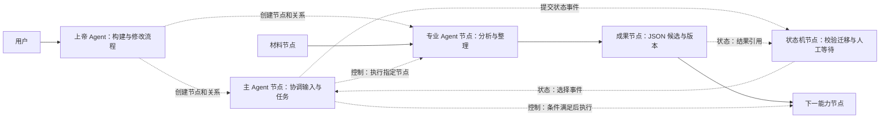

# 画布原生 Agent Flow

日期：2026-10-13。状态：**C0/C1/C2 已验收；C3.1a 底座与 C3.1b 专业 Agent 画布任务已接通，真实模型路径已验证，最终门禁见台账**。本目录是当前 Agent Flow 的唯一方案入口；不沿用已撤回方案的完成状态、工单编号或数据模型。

用户已确认完整方向并授权开发。优先阅读 [完整确认方案](00-approved-plan.md)；进度和交付备注见 [开发台账](08-development-ledger.md)。首版新增 Agent、状态机、AI 审核三种类型，细节按最新方案统一。

C3.2 交付路径见 [协作目标修订与人工过渡](15-c32-collaboration.md)：讨论不隐式执行；人工意见/固定选择与明确继续分开；采用新目标准备新任务，旧任务、输入及回执不改写。验收状态见台账。

2026-10-13 的代码、验证证据、真实模型待办和接续顺序见 [C3.2 开发交接](HANDOFF_2026_10_13_C32.md)。

C2 首包实现与边界见 [资产版本](11-c2-asset-versions.md)：文本/JSON/处理结果可提交版本、查看历史、放到画布并由普通端口消费；生产命令桥的确定性首条路径见 C2.2。

C2.2 的 [生产命令桥](12-c2-production-command-bridge.md) 已接入确定性数据处理首条路径：持久 pending/占用、桌面派发、公共执行、保存与资产回执、unknown 跨进程核对；最终全量门禁已通过。专业 Agent 自主循环已接入 C3.1b；真实 AI 审核仍待后续。

最新细化见 [详细实施方案](06-implementation-plan.md)：明确人机协作 Agent、纯 AI Agent、纯人工节点与单次处理节点；可交付内容统一称资产；Agent 可绑定版本化 Skill 和受控工具。建议 LangGraph 管理任务循环与恢复，LangChain 提供组件；先做 C0 兼容验证，再按 C1–C4 实施。LangGraph 已进入 C3 专业 Agent 的生产循环，业务执行复用 C2。

新增 [AI 审核与受控返工方案](07-ai-review-node.md)：首版新增类型为 Agent、状态机、AI 审核。审核输出“是/否”及反馈；返工按人工/AI/人机协作主体处理，控制反馈不混入数据 DAG。审核报告也是可查看、保存和连接的资产。

## 产品约束

> 上帝 Agent 根据用户要求构建画布中的 Agent Flow。主 Agent 节点协调流程、输入和产物，专业 Agent 节点承担复杂任务，已有能力节点完成具体加工，成果节点承载成果，状态机节点记录并校验流程状态迁移。操作、讨论、修改、选择和继续都发生在画布内。

1. **主 Agent 必须是画布节点。** 用户在节点内给出目标、讨论、启动、暂停和接管；不能用独立聊天工作台代替它。
2. **执行必须落到真实节点。** Agent 的控制指令必须能定位到画布节点、端口、连线或子图；业务内容加工调用能力节点。
3. **成果必须由节点承载。** 成果可查看、编辑、引用、连接和保存；聊天中的“已完成”不构成交付。
4. **首版包含状态机节点。** 声明状态、事件、条件和迁移，承载当前阶段、等待原因和人工继续操作；执行事实来自真实运行记录。
5. **画布语义图是唯一可编辑流程定义。** 执行快照、日志和后台存储服务于该图，不另造一份任务拓扑让用户维护。
6. **所有协作在画布内完成。** 可展开节点、放大节点或定位关联节点；关闭展开视图后，目标、状态和成果仍在原画布上。
7. **现有节点持续可用。** 原有 28 种节点、连线、组合、媒体和手动流程是演进基础。Agent 模式不能隐式隐藏原节点。
8. **本地个人使用。** “协作”指人、主 Agent 和能力节点共同工作，不引入团队、账户、云端流程或远程控制的产品前提。

## 阅读顺序

| 文档                                               | 解决的问题                                             |
| -------------------------------------------------- | ------------------------------------------------------ |
| [产品与节点交互](01-product.md)                    | 主 Agent、状态、能力、成果怎样在同一画布协作           |
| [架构与能力暴露](02-architecture.md)               | 单一图定义、控制与执行、工具契约、状态持久化和扩展边界 |
| [实施与验收](03-delivery.md)                       | 按可见用户行为交付，每步的退出条件与原功能保护         |
| [开源参考与清理记录](04-references-and-cleanup.md) | 借鉴范围、旧内容退出、当前证据及未实现边界             |
| [节点协同规范](05-node-coordination-standard.md)   | Agent 分工、状态机、结果承载与主 Agent 调度的统一契约  |
| [详细实施方案](06-implementation-plan.md)          | 参与方式、Skill/工具、资产版本、框架、模块工单与验收   |
| [AI 审核节点](07-ai-review-node.md)                | 标准输入输出、通过门禁、三类主体返工及有界循环         |

## 一个贯穿首版的实例

用户让上帝 Agent 构建“材料分析 → JSON 整理 → 人工选择”的流程，再由主 Agent 协调运行。

实线表达数据输入；虚线标注控制或状态语义。具体线型仍须遵守现有视觉规范，并同时提供文字/图标识别。示意图不代表功能已实现。

主 Agent 与专业 Agent 复用新增的 Agent 节点类型，通过角色和能力权限区分。上帝 Agent 的具体交互载体尚待确定；不得据此建立画布外的流程工作台。专业 Agent 从首版参与运行，不留到后续才设计。

首版必须能在这张画布中完成创建、执行、修改、等待、选择、继续和保存重开。主 Agent 的控制循环不把所有节点无差别自动执行，也不依据屏幕位置推断关系。

## 本次交付边界

本次交付新方案、旧方案清理及仓库入口更新。没有新增节点、修改执行器、安装框架或迁移数据库。已撤回的实现不作为已完成底座；开工须逐项核对现有代码。

后续每次实现先描述一个可在画布中演示的行为，再确定最小代码范围。文档存在、接口存在或测试通过，均不能替代该行为验收。

模型能力与生产桥结论见 [审阅记录](09-model-probe-and-production-bridge-review.md)。

C3 已开工：[C3.1a 有界运行底座](13-c3-runtime-foundation.md)实现版本化内容 Skill、任务预算、C2 工具适配和持久 interrupt/checkpoint。画布入口及真实模型循环见 C3.1b，不标记全部 C3 完成。

C3.1b [画布 Agent 任务入口](14-c3-canvas-agent.md)已接通专业 Agent 的启动/停止/继续、内置 Skill/工具选择、正式输出和固定资产；真实豆包连续执行及跨进程人工继续已验证。最终门禁见台账。主控/搭建、审核返工、多 Agent、Skill 导入和 C4 恢复矩阵仍待开发。

最新 C1 用户路径、验证与边界见 [控制声明交付](10-c1-control-declarations.md)。
