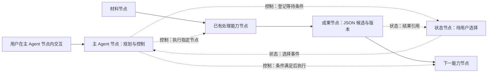

# 画布原生 Agent Flow

日期：2026-10-11。状态：**依据用户指导重新制定的方案，尚未实现**。本目录是当前 Agent Flow 的唯一方案入口；不沿用已撤回方案的完成状态、工单编号或数据模型。

## 产品约束

> 整个画布是人与 Agent 协作的场所。主 Agent 本身是主 Agent 节点，负责控制流程；能力节点完成执行，成果节点承载成果，状态节点承载可查看、可参与的状态。操作、讨论、修改、选择和继续都发生在画布内。

1. **主 Agent 必须是画布节点。** 用户在节点内给出目标、讨论、启动、暂停和接管；不能用独立聊天工作台代替它。
2. **执行必须落到真实节点。** Agent 的控制指令必须能定位到画布节点、端口、连线或子图；业务内容加工调用能力节点。
3. **成果必须由节点承载。** 成果可查看、编辑、引用、连接和保存；聊天中的“已完成”不构成交付。
4. **状态可以是独立节点。** 首版包含状态节点，承载当前阶段、等待原因、待选结果和人工继续操作。执行事实来自真实运行记录。
5. **画布语义图是唯一可编辑流程定义。** 执行快照、日志和后台存储服务于该图，不另造一份任务拓扑让用户维护。
6. **所有协作在画布内完成。** 可展开节点、放大节点或定位关联节点；关闭展开视图后，目标、状态和成果仍在原画布上。
7. **现有节点持续可用。** 原有 28 种节点、连线、组合、媒体和手动流程是演进基础。Agent 模式不能隐式隐藏原节点。
8. **本地个人使用。** “协作”指人、主 Agent 和能力节点共同工作，不引入团队、账户、云端流程或远程控制的产品前提。

## 阅读顺序

| 文档                                               | 解决的问题                                             |
| -------------------------------------------------- | ------------------------------------------------------ |
| [产品与节点交互](01-product.md)                    | 主 Agent、状态、能力、成果怎样在同一画布协作           |
| [架构与能力暴露](02-architecture.md)               | 单一图定义、控制与执行、工具契约、状态持久化和扩展边界 |
| [实施与验收](03-delivery.md)                       | 按可见用户行为交付，每步的退出条件与原功能保护         |
| [开源参考与清理记录](04-references-and-cleanup.md) | 借鉴范围、旧内容退出、当前证据及未实现边界             |

## 一个贯穿首版的实例

用户在主 Agent 节点输入：“把这份材料整理成 JSON，等我选好结果后再继续。”

实线表达数据输入；虚线标注控制或状态语义。具体线型仍须遵守现有视觉规范，并同时提供文字/图标识别。示意图不代表功能已实现。

首版必须能在这张画布中完成创建、执行、修改、等待、选择、继续和保存重开。主 Agent 的控制循环不把所有节点无差别自动执行，也不依据屏幕位置推断关系。

## 本次交付边界

本次交付新方案、旧方案清理及仓库入口更新。没有新增节点、修改执行器、安装框架或迁移数据库。已撤回的实现不作为已完成底座；开工须逐项核对现有代码。

后续每次实现先描述一个可在画布中演示的行为，再确定最小代码范围。文档存在、接口存在或测试通过，均不能替代该行为验收。
