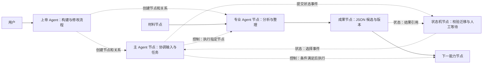

# 画布原生 Agent Flow

本次源码同步入口：[2026-10-15 C4 竞争恢复与视频 Agent 总 handoff](HANDOFF_2026_10_15_VIDEO_AGENT_SYNC.md)。包含 26–29 包源码、测试和备注；最终完整 verify 退出码 0（1857 项通过、1 项既有跳过，模型另 2，浏览器/桌面全过）。当前支持文生视频与单张首帧，下一步首尾帧双图适配。下方未提交状态为历史记录，最终提交身份以总 handoff 所在 commit 与远端 main 核对为准。

最新本地接续：[视频首帧图片适配](29-video-first-frame-adapter.md)。普通图片固定版本和内容摘要、单首帧加可选文本、原命令/原任务恢复与固定图片呈现已接通；实际边界及门禁见交接。继续功能开发，26–29 包尚未提交/推送。

最新本地接续：[媒体节点接入 Agent Flow：文本生成视频](28-video-agent-adapter.md)。主控分派、原视频命令绑定、unknown 重开接回、固定视频版本与成果节点已接通；桌面双进程使用合成供应商/SDK 协议夹具，不请求付费视频。用户已明确继续功能开发，不做打包或旧项目迁移专项。当前 26–28 包尚未提交/推送。

最新本地接续：[C4 组合故障验收](27-c4-combined-failure-acceptance.md)。unknown/停止/prepared 强杀/保存中断/双进程继续组合已通过，并修复转正期间停止仍登记媒体的竞争窗口。完整证据与未覆盖范围见该文档，26–27 包尚未提交/推送，安装包未更新。

最新本地接续：[多进程恢复竞争与遗留锁争抢](26-c4-recovery-contention.md)。SQLite v17 持久所有权、旧文件锁串行接管、视频跨进程排他与迟到令牌保护已实现，验收见该文档。本包未提交/推送，安装包未更新；下方总 handoff 保留同步基线。

当前源码同步接续入口：[C4 保存、供应商核对与成果恢复总 handoff](HANDOFF_2026_10_14_C4_RELIABILITY_SYNC.md)。本批包含 23–25 三包代码/测试/备注；下方“未提交/推送”是开发期历史状态，以总 handoff 和包含它的 Git commit 为准。下一步多进程恢复竞争，桌面安装包未更新。

最新本地接续：[视频成果入库强杀恢复](25-c4-video-materialization-recovery.md)。固定媒体身份与完整下载回执、离线核对优先、SQLite 原子登记及串行重开恢复已定向验收；多进程同时物化仍待下一包。源码未提交/推送，门禁结果见接续记录。

最新本地接续：[供应商事实核对与 unknown 裁决](24-c4-supplier-reconciliation.md)。已有视频路径接官方 Ark 身份/连接校验查询，未知占用阻止新计费提交，停止意图持久；混合 DELETE 未自动作为撤回，同步 Agent 未具备可信远端查询/取消身份。范围/门禁见该文档，源码未提交/推送。

最新本地接续：[main 保存轮转强杀与遗留锁恢复](23-c4-main-save-crash-recovery.md)。五个保存切点和新锁持有者保护已定向验收；完整门禁结果见该记录，源码未提交/推送。发布基线 handoff 与下方分包状态为此前交付记录。

日期：2026-10-14。状态：**C3.3 文本/JSON 首批及 C4 核对、补呈现、迁移和首批故障矩阵已验收；main 文件轮转五个强杀边界已新增定向验收，掉电与远端裁决等边界待补**。本目录是当前 Agent Flow 的唯一方案入口；不沿用已撤回方案的完成状态、工单编号或数据模型。

接续开发先读 [GLM / C3.3 / C4 发布 handoff](HANDOFF_2026_10_14_C4_RELEASE.md)，其中汇总当前实现、验证、同步备注和下一条交付路径；[历史分包交接](HANDOFF_2026_10_14_REPOSITORY_SYNC.md)保留。

2026-10-14 本地模型调整：新建 Agent/审核默认 GLM-5.3，对话与识图模型选择 GLM-5.3-Flash。请求策略与个人配置边界见 [模型切换记录](18-glm-model-switch.md)。GLM 建图、固定版本审核和三类返工真实桌面路径已通过，最新门禁与边界见 [C3.3 返工验收](19-c33-review-rework.md)；个人模型配置不随源码分发。

用户已确认完整方向并授权开发。优先阅读 [完整确认方案](00-approved-plan.md)；进度和交付备注见 [开发台账](08-development-ledger.md)。首版新增 Agent、状态机、AI 审核三种类型，细节按最新方案统一。

C3.2 已完成收尾验收。C3.3 已接通 [主 Agent 顺序协调与固定成果交接](16-c33-sequential-coordination.md)、[文本模板建图与审核](17-c33-builder-review.md)，并完成 [主控自动审核与三类有界返工](19-c33-review-rework.md) 的文本/JSON 首批验收。媒体、并行及任意节点建图仍需独立适配；C4 尚未实现。

C3.2 交付路径见 [协作目标修订与人工过渡](15-c32-collaboration.md)：讨论不隐式执行；人工意见/固定选择与明确继续分开；采用新目标准备新任务，旧任务、输入及回执不改写。验收状态见台账。

2026-10-13 的代码、验证证据、真实模型待办和接续顺序见 [C3.2 开发交接](HANDOFF_2026_10_13_C32.md)。

C2 首包实现与边界见 [资产版本](11-c2-asset-versions.md)：文本/JSON/处理结果可提交版本、查看历史、放到画布并由普通端口消费；生产命令桥的确定性首条路径见 C2.2。

C2.2 的 [生产命令桥](12-c2-production-command-bridge.md) 已接入确定性数据处理首条路径：持久 pending/占用、桌面派发、公共执行、保存与资产回执、unknown 跨进程核对；最终全量门禁已通过。专业 Agent 自主循环已接入 C3.1b；真实固定版本 AI 审核与人工复审见 C3.3 接续。

最新细化见 [详细实施方案](06-implementation-plan.md)：明确人机协作 Agent、纯 AI Agent、纯人工节点与单次处理节点；可交付内容统一称资产；Agent 可绑定版本化 Skill 和受控工具。建议 LangGraph 管理任务循环与恢复，LangChain 提供组件；先做 C0 兼容验证，再按 C1–C4 实施。LangGraph 已进入 C3 专业 Agent 的生产循环，业务执行复用 C2。

新增 [AI 审核与受控返工方案](07-ai-review-node.md)：首版新增类型为 Agent、状态机、AI 审核。审核输出“是/否”及反馈；返工按人工/AI/人机协作主体处理，控制反馈不混入数据 DAG。审核报告也是可查看、保存和连接的资产。

## 产品约束

> 上帝 Agent 根据用户要求构建画布中的 Agent Flow。主 Agent 节点协调流程、输入和产物，专业 Agent 节点承担复杂任务，已有能力节点完成具体加工，成果节点承载成果，状态机节点记录并校验流程状态迁移。操作、讨论、修改、选择和继续都发生在画布内。

1. **主 Agent 必须是画布节点。** 用户在节点内给出目标、讨论、启动、暂停和接管；不能用独立聊天工作台代替它。
2. **执行必须落到真实节点。** Agent 的控制指令必须能定位到画布节点、端口、连线或子图；业务内容加工调用能力节点。
3. **成果必须由节点承载。** 成果可查看、编辑、引用、连接和保存；聊天中的“已完成”不构成交付。
4. **首版包含状态机节点。** 声明状态、事件、条件和迁移，承载当前阶段、等待原因和人工继续操作；执行事实来自真实运行记录。
5. **画布语义图是唯一可编辑流程定义。** 执行快照、日志和后台存储服务于该图，不另造一份任务拓扑让用户维护。
6. **所有协作在画布内完成。** 可展开节点、放大节点或定位关联节点；关闭展开视图后，目标、状态和成果仍在原画布上。
7. **现有节点持续可用。** 原有 28 种节点、连线、组合、媒体和手动流程是演进基础。Agent 模式不能隐式隐藏原节点。
8. **本地个人使用。** “协作”指人、主 Agent 和能力节点共同工作，不引入团队、账户、云端流程或远程控制的产品前提。

## 阅读顺序

| 文档                                               | 解决的问题                                             |
| -------------------------------------------------- | ------------------------------------------------------ |
| [产品与节点交互](01-product.md)                    | 主 Agent、状态、能力、成果怎样在同一画布协作           |
| [架构与能力暴露](02-architecture.md)               | 单一图定义、控制与执行、工具契约、状态持久化和扩展边界 |
| [实施与验收](03-delivery.md)                       | 按可见用户行为交付，每步的退出条件与原功能保护         |
| [开源参考与清理记录](04-references-and-cleanup.md) | 借鉴范围、旧内容退出、当前证据及未实现边界             |
| [节点协同规范](05-node-coordination-standard.md)   | Agent 分工、状态机、结果承载与主 Agent 调度的统一契约  |
| [详细实施方案](06-implementation-plan.md)          | 参与方式、Skill/工具、资产版本、框架、模块工单与验收   |
| [AI 审核节点](07-ai-review-node.md)                | 标准输入输出、通过门禁、三类主体返工及有界循环         |

## 一个贯穿首版的实例

用户让上帝 Agent 构建“材料分析 → JSON 整理 → 人工选择”的流程，再由主 Agent 协调运行。

实线表达数据输入；虚线标注控制或状态语义。具体线型仍须遵守现有视觉规范，并同时提供文字/图标识别。示意图不代表功能已实现。

主 Agent 与专业 Agent 复用新增的 Agent 节点类型，通过角色和能力权限区分。上帝 Agent 的具体交互载体尚待确定；不得据此建立画布外的流程工作台。专业 Agent 从首版参与运行，不留到后续才设计。

首版必须能在这张画布中完成创建、执行、修改、等待、选择、继续和保存重开。主 Agent 的控制循环不把所有节点无差别自动执行，也不依据屏幕位置推断关系。

## 本次交付边界

最初方案发布仅交付设计与旧方案清理。后续已实现 C0–C3.3 的部分能力并迁移数据库至 v16；当前实现、验证与未支持范围以 [当前 handoff](HANDOFF_2026_10_14_REPOSITORY_SYNC.md)和台账为准。已撤回的实现不作为已完成底座。

后续每次实现先描述一个可在画布中演示的行为，再确定最小代码范围。文档存在、接口存在或测试通过，均不能替代该行为验收。

模型能力与生产桥结论见 [审阅记录](09-model-probe-and-production-bridge-review.md)。

C3 已开工：[C3.1a 有界运行底座](13-c3-runtime-foundation.md)实现版本化内容 Skill、任务预算、C2 工具适配和持久 interrupt/checkpoint。画布入口及真实模型循环见 C3.1b，不标记全部 C3 完成。

C3.1b [画布 Agent 任务入口](14-c3-canvas-agent.md)已接通专业 Agent 的启动/停止/继续、内置 Skill/工具选择、正式输出和固定资产。主控、搭建、审核及三类返工验收见 C3.3；C4 首批见下方。并行、Skill 导入及完整恢复矩阵继续按能力适配验收。

最新 C1 用户路径、验证与边界见 [控制声明交付](10-c1-control-declarations.md)。

当前交付：[C4 故障核对与迁移](20-c4-recovery-transfer.md)、[强杀/断网矩阵](21-c4-crash-network-matrix.md)及[导入/renderer 中断](22-c4-import-renderer-recovery.md)。文本/JSON、命令存储、导入事务强杀及四类 renderer 保存崩溃已验收；main 文件轮转、物理掉电、供应商查询和媒体/并行仍未覆盖。进度以最新台账条目为准。
